### 🦇 The person under the cowl

- Computer Science student at **Air University, Islamabad**, graduating in 2027
- **Associate Software Engineer at Eon** on the Data & Integrations team (2025–26): HL7 parsing, JSON/XML integrations, webhooks and AWS Lambda for healthcare data
- I build where systems meet: REST APIs, data pipelines, and AI tools that answer questions from your documents
- Currently on patrol for: software engineering roles and interesting integration problems

### 🌙 From the Batcave

  
  
  
  

### 🛠️ Utility belt

### 🗂️ Case files

| Case | What it is | Built with |
|---|---|---|
| [**OVERCUT**](https://github.com/muhmmadalikhan94/f1_OVERCUT_app) | F1 companion app with live positions, gaps, tyres, standings and paddock news | Flutter · Dart · OpenF1 |
| [**EventPulse**](https://github.com/muhmmadalikhan94/Project_EventPulse) · [live](https://eventpulse-tawny.vercel.app/login) | Installable event and ticketing PWA with an admin dashboard | MongoDB · Express · React · Node |
| [**ProductCatalog**](https://github.com/muhmmadalikhan94/ProductCatalog) | REST catalog API with stock audit trail, search and Swagger docs | C# · .NET 8 · EF Core |
| [**Digit Recognition**](https://github.com/muhmmadalikhan94/handwritten-digit-recognition) | CNN trained on MNIST with data augmentation | Python · TensorFlow |
| [**Cipher Tool**](https://github.com/muhmmadalikhan94/Cipher-and-Decryption-tool-) | Caesar, Vigenère and AES encryption from the command line | Python |
| [**iTutorsWorld**](https://github.com/muhmmadalikhan94/itutorsworld) | Tutoring platform with dashboards and session scheduling | C# · ASP.NET |

### 🌃 Patrol log

Redrawn every night by a GitHub Action from my contribution graph.

 

*"It's not who I am underneath, but what I ship that defines me."*

